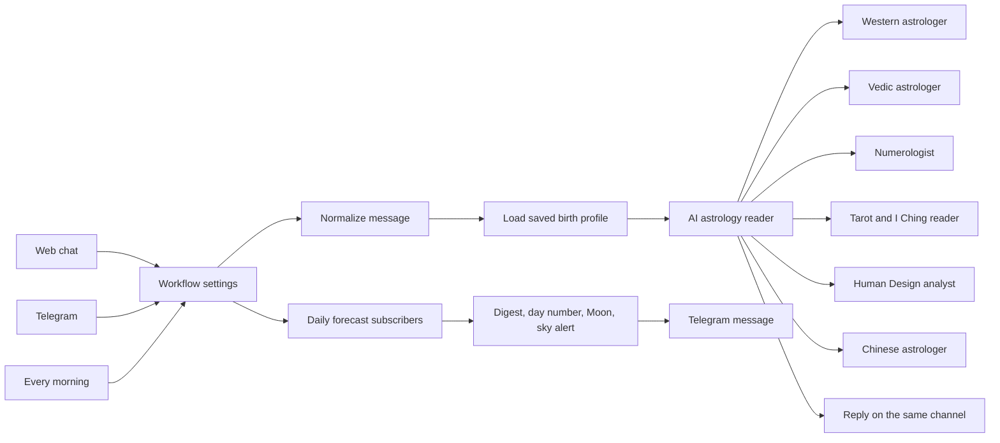

  

# n8n AI Astrology Chatbot Template: Multi-Agent Readings for Birth Charts, Vedic Kundli, Tarot, Numerology and Daily Forecasts

> An import-ready n8n workflow for AI astrology readings on web chat and Telegram. A reader agent hands each question to specialist agents for Western astrology, Vedic astrology, numerology, tarot and I Ching, Human Design and Chinese BaZi, remembers every birth profile, writes cross-system compatibility reports and sends each subscriber a personal forecast every morning. Every chart, number and card comes from a live [RoxyAPI](https://roxyapi.com) calculation verified against NASA JPL Horizons, not from the model, and it runs on Google Gemini, OpenAI or Anthropic.

## Is there a video walkthrough?

Yes. [n8n AI astrology chatbot: multi-agent readings with one RoxyAPI key](https://youtu.be/QYLg9g_YrzE) imports this workflow from its GitHub URL, creates the profile table, adds the RoxyAPI and Gemini keys, connects one model to the model selector, then asks for a birth chart and a four-system compatibility report.

## What does this n8n workflow do?

It runs a full AI astrology reading service inside n8n:

- **Answers on web chat and Telegram** through one shared path, replying on the channel each message came from.
- **Remembers every person.** The first time someone shares a birth date, time and city, the reader resolves the city and saves the birth profile to an n8n Data Table. Every later conversation starts from that profile.
- **Delegates to specialists.** The reader agent routes each question to the specialist that owns it, so every agent keeps a short, focused prompt and only the tools it needs.
- **Writes compatibility reports across four systems.** One request runs Western synastry, Vedic Ashtakoot gun milan, numerology compatibility and BaZi compatibility, then combines them into one verdict with the result from each system, where they agree and where they differ.
- **Sends a personal forecast every morning** to Telegram subscribers: the personal day number, the Moon phase, the strongest transits of the week from their own chart, and a sky alert on days with a major transit or a new or full Moon.

## Which specialists and RoxyAPI tools does it use?

| Specialist | RoxyAPI tools (Resource → Operation) |
|---|---|
| AI astrology reader | Location and Timezone → Search Cities, Forecast → Generate Digest, plus the Save birth profile Data Table tool |
| Western astrologer | Generate Natal Chart, Calculate Transit Aspects, Generate Progressions, Calculate Synastry, Get Daily Horoscope |
| Vedic astrologer | Generate Birth Chart (kundli), Get Current Dasha, Get Basic Panchang, Detect Yogas, Check Manglik Dosha, Calculate Gun Milan |
| Numerologist | Generate Numerology Chart, Calculate Personal Day, Calculate Numerology Compatibility |
| Tarot and I Ching reader | Cast Three Card, Cast Love Spread, Cast Celtic Cross, Cast Yes No, I-Ching → Cast Reading |
| Human Design analyst | Generate Bodygraph, Calculate Connection |
| Chinese astrologer | Generate Bazi Chart, Calculate Annual Forecast, Calculate Bazi Compatibility |

The city search returns coordinates and an IANA timezone, so a summer birth and a winter birth both get the correct daylight saving offset. Nobody is ever asked for latitude or longitude.

## How do I import it into n8n?

1. **Install the RoxyAPI node**: in the nodes panel, search for **RoxyAPI**, select it and press **Install node**. It is a verified community node, so this works on n8n Cloud and self-hosted n8n.
2. **Import the workflow**: download [`ai-astrology-chatbot.json`](https://github.com/RoxyAPI/n8n-ai-astrology-chatbot/releases/latest/download/ai-astrology-chatbot.json) from the latest release, then in a new workflow open the **⋯** menu and choose **Import from File**.
3. **Create the profile table**: run **Run once to create the profile table**. It creates the `astrology_profiles` Data Table and reuses it when it already exists.
4. **Add your RoxyAPI key**: open any RoxyAPI node and create a credential with your key from [roxyapi.com/pricing](https://roxyapi.com/pricing). The other RoxyAPI nodes reuse it.
5. **Pick your AI provider**: add a key to the Google Gemini, OpenAI or Anthropic model node and set **aiProvider** in **Workflow settings** to `gemini`, `openai` or `anthropic`.
6. **Telegram (optional)**: add a bot token from BotFather to the three Telegram nodes, or delete them for web chat only.
7. **Activate** the workflow and press **Open chat**.

## Do I need keys for all three AI providers?

No. n8n activates a workflow only when every connected model has a credential, so keep the providers you have keys for. With one key, delete the other two model nodes and connect your model to all three **Model** inputs of **Model selector**; it takes about thirty seconds. With two or three keys, switch between them any time by changing **aiProvider**.

## How does the reader decide what to do?

The system message on **AI astrology reader** sets the rules: every fact about a chart, number, card or forecast comes from a tool or a specialist, missing birth details are asked for one at a time, an unknown birth time falls back to 12:00 with a note that the rising sign, houses and hour pillar may be off, every city is resolved before a chart, and replies stay warm and specific without presenting health, legal or financial outcomes as certain. Specialists do not see the conversation, so the reader passes each one the question and every birth detail it needs in one message.

## How do the daily forecast and sky alerts work?

On Telegram the reader offers a daily forecast once a profile is saved and stores the answer in the profile. Every morning at 7 the schedule reads every subscriber, calls the personal forecast digest, the personal day number and the current Moon phase, and flags a sky alert when today holds a new or full Moon or a transit of high significance to the chart of that person. A model turns the data into a short message, which goes out on Telegram. Saying stop in the chat turns it off.

## Can I put the chat on my own website?

Yes. The chat trigger is set to **Hosted Chat**, so once the workflow is active it serves a public chat page with the title, subtitle and greeting already written. Switch its mode to **Embedded Chat** to place it inside your own site instead.

## How do I customize the workflow?

- **Widen a specialist**: add another RoxyAPI node on its **Tool** input and pick any operation, from Vedic divisional charts and KP astrology to solar returns and astrocartography. Click the star on a field to let the model fill it; on a dropdown field, switch to **Expression** and use `{{ $fromAI('name', 'what the model should pass') }}`.
- **Add a specialist**: duplicate one, rename it, write its description and system message, and give it tools from another domain such as crystals, dreams, angel numbers, Ayurveda or feng shui. Then name it in the reader system message.
- **Answer in another language**: every RoxyAPI tool has a **Language** option under **Options** covering 10+ languages, and the reader already replies in the language the person writes in.
- **Change the morning hour**: edit **Every morning at 7**. It runs in the timezone of your n8n instance.
- **Remember longer**: raise **Context Window Length** on **Conversation memory**, or swap it for a database-backed memory for production traffic.

## What does it need?

| Requirement | Version |
|---|---|
| n8n | 2.x with Data Tables, n8n Cloud or self-hosted |
| RoxyAPI n8n node | `@roxyapi/n8n-nodes-roxyapi` 1.0.13 or newer |
| RoxyAPI key | Any plan; one key covers every domain |
| AI provider key | Google Gemini, OpenAI or Anthropic |
| Telegram bot | Optional, for Telegram chat and the daily forecast |

## Built with RoxyAPI

[RoxyAPI](https://roxyapi.com) is the Spiritual OS layer for agentic AI: Western and Vedic astrology, Human Design, numerology, tarot, the I Ching and many more insight domains on one API key, verified against NASA JPL Horizons, with typed SDKs, Remote MCP and flat pricing. Learn more in the [n8n guide](https://roxyapi.com/docs/integrations/n8n), the [API reference](https://roxyapi.com/api-reference), the [methodology](https://roxyapi.com/methodology) and the other [open source templates](https://roxyapi.com/templates).

## License

MIT. Clone it, rebrand it and ship it under your own brand.
