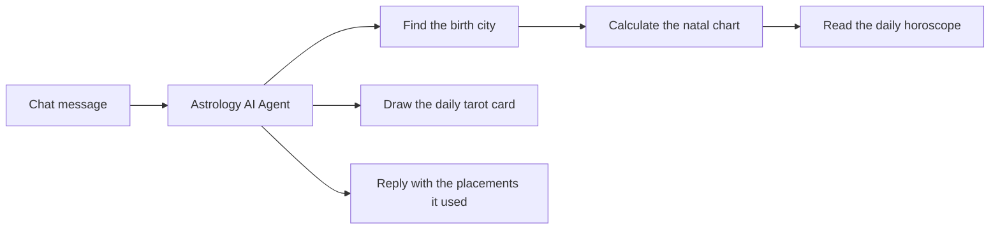

# n8n Astrology AI Agent Template: Natal Charts, Horoscopes and Tarot in One Chat

> An import-ready n8n workflow for an AI astrology companion. It asks for a birth date, time and city, finds the city, calculates the natal chart, reads the daily horoscope and draws a tarot card, and every fact in its replies comes from a live [RoxyAPI](https://roxyapi.com) calculation verified against NASA JPL Horizons, not from the model.

## What does this n8n workflow do?

It turns a plain chat into an astrology companion. A visitor writes "I am Maya, born 15 January 1990 at 2:30 pm in New York. What are my Sun, Moon and rising signs, and how does today look for me?" and the agent calls four RoxyAPI tools in order, then answers in its own words:

The reply names real placements (Sun in Capricorn, Moon in Virgo, Gemini rising for that birth), then the horoscope for the Sun sign and a card of the day. Nothing is invented: the model only phrases what the tools returned. Conversation memory keeps the birth details, so a follow-up question needs no repeat.

## How do I import it into n8n?

1. **Install the RoxyAPI node**: in the nodes panel, search for **RoxyAPI**, select it and press **Install node**. It is a verified community node, so this works on n8n Cloud and self-hosted n8n.
2. **Import the workflow**: download [`astrology-ai-agent.json`](https://github.com/RoxyAPI/n8n-astrology-ai-agent/blob/main/astrology-ai-agent.json), then in a new workflow open the **⋯** menu and choose **Import from File**.
3. **Add two keys**: open any RoxyAPI tool, create a credential with your key from [roxyapi.com/pricing](https://roxyapi.com/pricing) (the other three tools reuse it), then open **Chat model** and add a key for it.

Press **Open chat** and try the message above. The sticky notes on the canvas repeat these steps.

## Is there a video tutorial?

Yes. [Astrology AI agent in n8n](https://youtu.be/oaFNfWYk2PA) builds this agent from an empty canvas in under three minutes: install the RoxyAPI node, add the chat trigger, the agent, a chat model and memory, connect the city search, natal chart and daily horoscope tools, then ask a birth chart question and read the answer.

## Which RoxyAPI tools does the agent call?

| Tool on the canvas | Resource → Operation | What the model fills |
|---|---|---|
| Find the birth city | Location and Timezone → Search Cities | The birth city |
| Calculate the natal chart | Western Astrology → Generate Natal Chart | Date, time, latitude, longitude and timezone of the first city result |
| Read the daily horoscope | Western Astrology → Get Daily Horoscope | The zodiac sign, usually the Sun sign from the chart |
| Draw the daily tarot card | Tarot → Get Daily Card | The first name, so each person gets their own card of the day |

The city search resolves coordinates and an IANA timezone, so a birth date in summer and one in winter both get the correct daylight saving offset. Nobody is ever asked for latitude or longitude.

## How does the agent decide what to do?

The system message on **Astrology AI Agent** sets five rules: every chart fact comes from a tool call, missing birth details are asked for one at a time, an unknown birth time falls back to 12:00 with a note that the rising sign may be off, the city is always resolved before the chart, and replies stay warm and short without presenting health, legal or financial outcomes as certain. Edit that message to change the voice.

## How do I customize the workflow?

- **Add more domains**: add another RoxyAPI node on the **Tool** input and pick any of 261+ operations across 18+ domains: Vedic kundli, synastry and compatibility, numerology, Human Design, Chinese BaZi, I Ching and more. Click the star on a field to let the model fill it; on a dropdown field, switch to **Expression** and use `{{ $fromAI('name', 'what the model should pass') }}`.
- **Change the model**: the **Chat model** node ships as a Google Gemini model; replace it with any chat model n8n supports (OpenAI, Anthropic, Mistral, a local model).
- **Answer in another language**: every RoxyAPI tool has a **Language** option under **Options** covering 10+ languages; tell the agent in its system message to reply in the same language.
- **Remember longer**: raise **Context Window Length** on **Conversation memory**, or swap it for a database-backed memory for production traffic.

## Can I put the chat on my own website?

Yes. The chat trigger is set to **Hosted Chat**, so once the workflow is active it serves a public chat page with the title, subtitle and greeting already written. Switch its mode to **Embedded Chat** to place it inside your own site instead.

## What does it need?

| Requirement | Version |
|---|---|
| n8n | 2.x, n8n Cloud or self-hosted |
| RoxyAPI n8n node | `@roxyapi/n8n-nodes-roxyapi` 1.0.2 or newer |
| RoxyAPI key | Any plan; one key covers every domain |
| Chat model key | Any provider with an n8n chat model node |

## Built with RoxyAPI

[RoxyAPI](https://roxyapi.com) is the Spiritual OS layer for agentic AI: 18+ insight domains on one API key, from Western and Vedic astrology to Human Design, numerology, tarot and the I Ching, verified against NASA JPL Horizons, with typed SDKs, Remote MCP and flat pricing. Learn more in the [n8n guide](https://roxyapi.com/docs/integrations/n8n), the [API reference](https://roxyapi.com/api-reference), the [methodology](https://roxyapi.com/methodology) and the other [open source templates](https://roxyapi.com/templates).

## License

MIT. Clone it, rebrand it and ship it under your own brand.
